# PRISMLOOM — Gamified Design Arena

Prompt → world. A creative coding playground with 16 WebGL scenes, 16 motion graphics studies, procedural audio, a 5,200+ prompt library, and an Inspiration Vault cataloguing what builders ship with Gemini, Argon 4, Opus 5.5, Fable 5.5, GPT-6, Astro, GPT-6.1, Soul, Muse Park, Muse Wonder 4. Runs 100% in the browser, zero API keys.

## Workflow

1. Open `/` and pick a surface.
2. `/arena` — switch among 16 Three.js scenes; cursor-reactive.
3. `/motion` — explore 16 framer-motion studies.
4. `/audio` — play 8 procedural Web Audio tracks.
5. `/prompts` — search 5,200+ prompts by vibe, stack, model, difficulty.
6. `/vault` — learn what each model family is used to build.

## Architecture

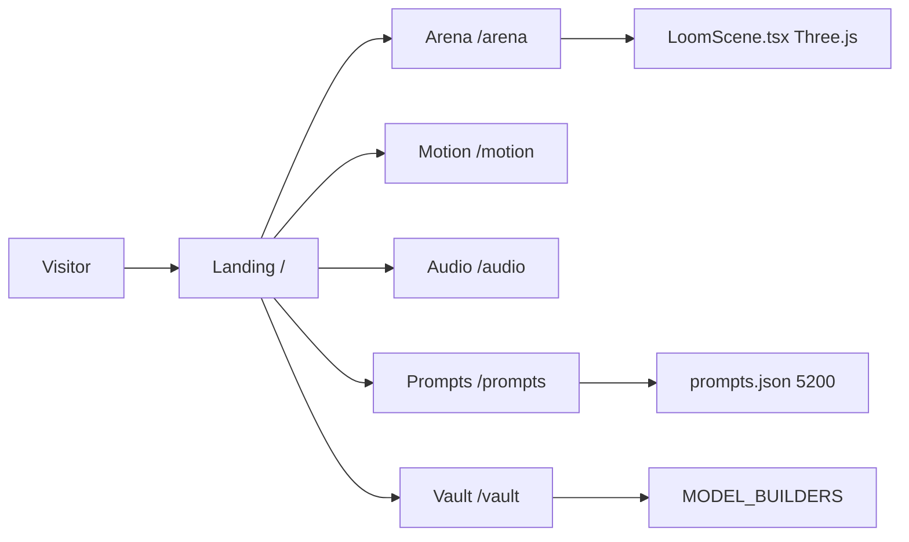

## Sequence

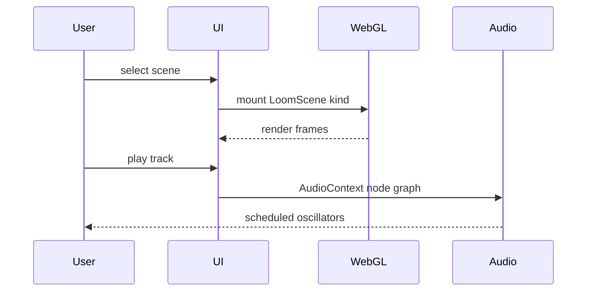

## Data flow

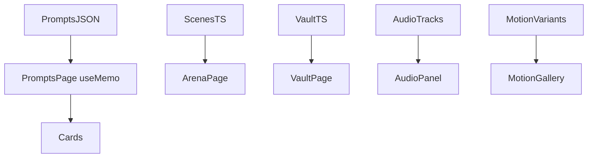

## Class

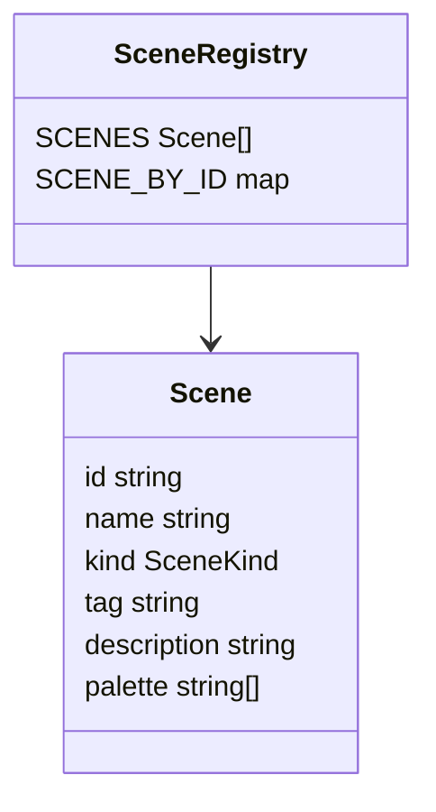

## State

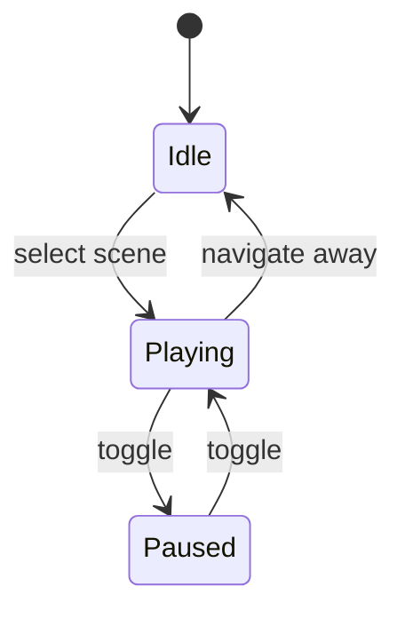

## CI/CD

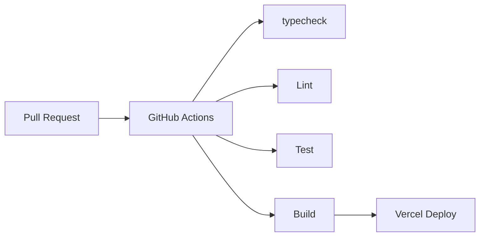

## User journey

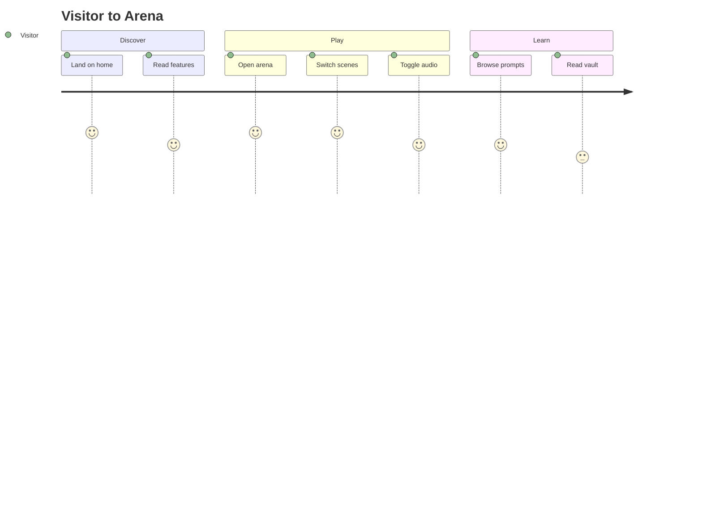

## Gantt

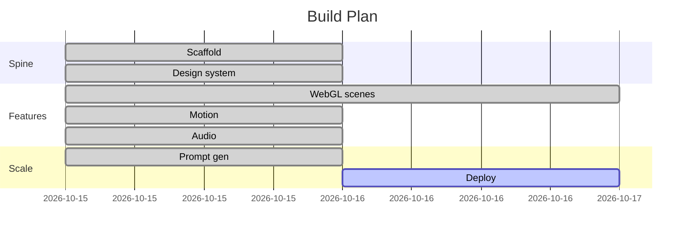

## ERD

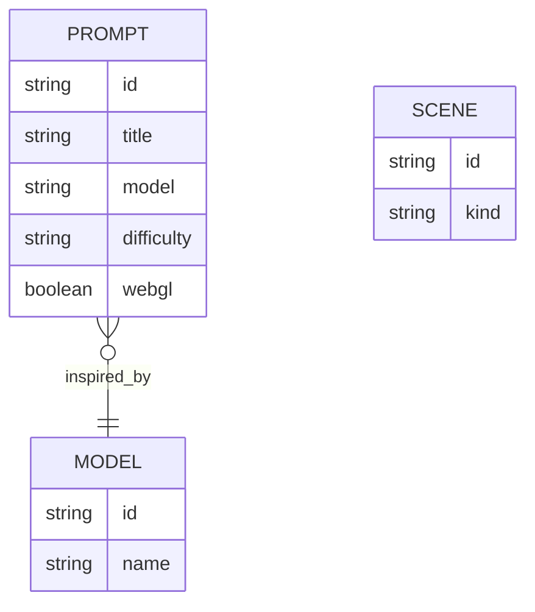

## Mindmap

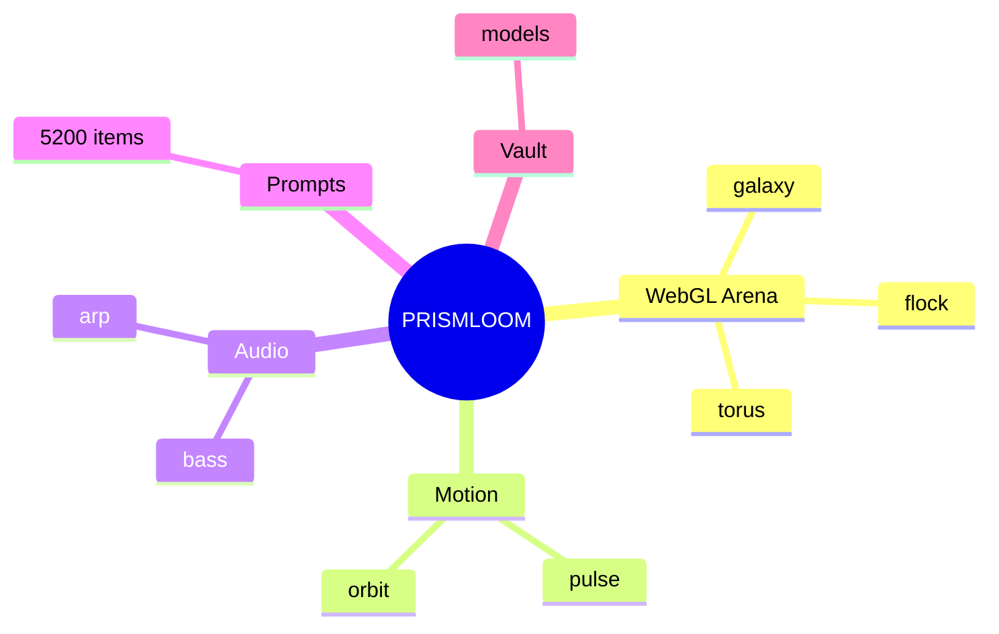

## Quadrant

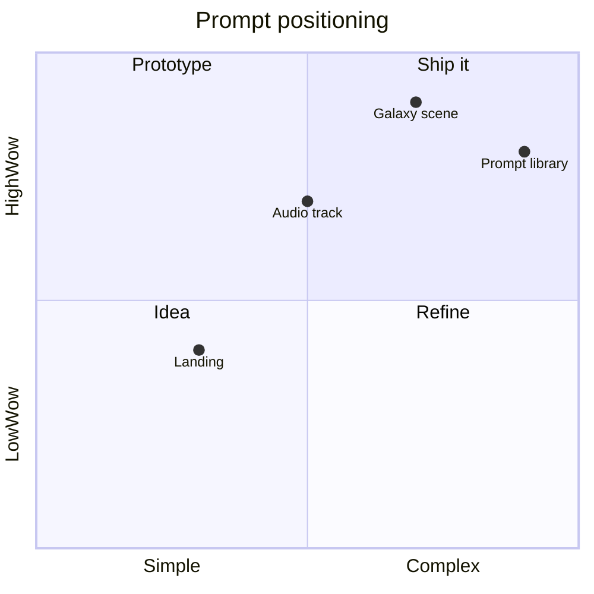

## Infrastructure

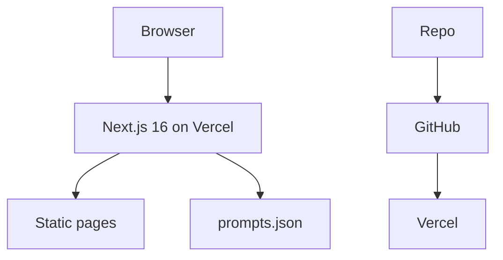

## Tech stack

- Next.js 16 (App Router) · React 19 · TypeScript strict
- Tailwind v4
- Three.js (+ @react-three? no; raw WebGL via three)
- Framer Motion
- Web Audio API
- Bun

## Scale

Run `bun scripts/loc-count.mjs`. Prompts are 5,200 entries (pretty-printed JSON). See `docs/diagrams/*.mmd` for sources.

## License

MIT
